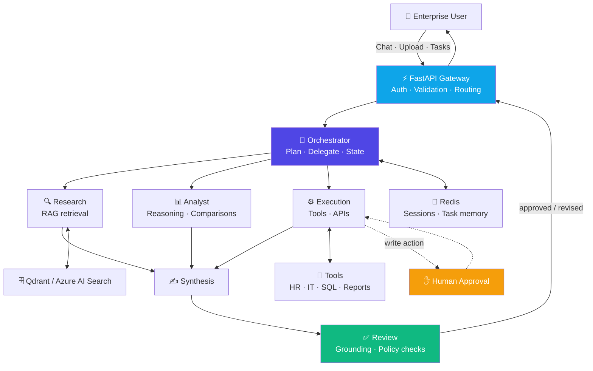
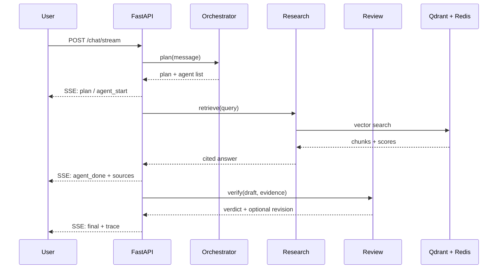

<div align="center">

# Multi-Agent Enterprise Assistant

**A locally powered, cloud-connected agentic AI platform for enterprise knowledge, automation, and governance.**

[](https://www.python.org/)
[](https://fastapi.tiangolo.com/)
[](tests/)
[]()
[](https://ollama.com/)
[](https://qdrant.tech/)

[Features](#-features) · [Architecture](#-architecture) · [Quick Start](#-quick-start) · [Documentation](#-documentation) · [API](#-api-reference) · [Deployment](#-deployment)

</div>

---

## ✨ Features

> Built for an **Agentic AI Engineer** portfolio — this is a working system, not a demo stub.

| Capability | What it demonstrates |
|---|---|
| 🧠 **6 specialized agents** | Orchestrator, Research, Analyst, Execution, Review, and Synthesis — each with a real, distinct responsibility |
| 🔍 **RAG with citations** | Vector search over company documents; every claim traces back to a clickable source excerpt |
| 🛠️ **Enterprise tools** | HR directory, IT tickets, read-only SQL, CSV reports — schema-validated and risk-classified |
| ✋ **Human approval gate** | Write actions pause until a human approves — nothing executes silently |
| 🔐 **Security & governance** | Optional API-key auth with RBAC, structured audit trail, document-level control |
| 📊 **Execution tracing** | Per-agent timings and outcomes, streamed live to the UI |
| 💾 **Stateful memory** | Redis-backed conversations and task context with in-process fallback |
| ☁️ **Cloud-ready** | Azure OpenAI, Azure AI Search, managed identity, Bicep + azd templates |
| 🎨 **Professional UI** | Streaming pipeline, approvals, sources drawer, KB manager, light/dark themes |

---

## 🏗️ Architecture



### The six agents

| Agent | Responsibility | Key behavior |
|---|---|---|
| **Orchestrator** | Plans and delegates | Classifies intent, selects agents, manages state, combines results |
| **Research** | Finds knowledge | Semantic search + citations; reports when evidence is missing |
| **Analyst** | Derives insight | Compares, calculates, identifies inconsistencies, recommends |
| **Execution** | Takes action | Calls tools/APIs behind allow-lists and the approval gate |
| **Review** | Verifies quality | Checks grounding, flags hallucinations, can rewrite the answer |
| **Synthesis** | Composes answer | Merges agent outputs into one clear, cited response |

### Request lifecycle



📖 **Full details:** [Architecture guide](docs/ARCHITECTURE.md) · [Agent reference](docs/AGENTS.md)

---

## 🚀 Quick Start

**Prerequisites:** Python 3.11+ · [Ollama](https://ollama.com/) (or Azure credentials) · optional Qdrant/Redis

```bash
# 1. Clone & install
git clone https://github.com/PrathamWankhade/Multi-agent-Enterprise-Assistant.git
cd Multi-agent-Enterprise-Assistant
pip install -r requirements.txt

# 2. Pull local models (no cloud credentials needed)
ollama pull qwen3.5:4b
ollama pull nomic-embed-text

# 3. Configure (local mode)
cp .env.example .env
# set: OPENAI_API_KEY=ollama
#      OPENAI_BASE_URL=http://localhost:11434/v1
#      OPENAI_MODEL=qwen3.5:4b
#      OPENAI_EMBEDDING_MODEL=nomic-embed-text

# 4. Run
python -m uvicorn app.main:app --host 127.0.0.1 --port 8000
```

Open **http://127.0.0.1:8000/** — the UI needs no build step.

> **Zero-config fallback:** leave `.env` empty and the app still works in mock mode with keyword retrieval. Placeholder values are detected and ignored — an unfinished config never breaks the app.

<details>
<summary><b>Run with Docker instead</b></summary>

```bash
docker compose up --build -d
curl http://localhost:8000/api/v1/health
```

The stack includes Qdrant + Redis with healthchecks and persistent volumes. Ollama is expected on the host at `host.docker.internal:11434`.
</details>

---

## 📚 Documentation

| Document | Description |
|---|---|
| 📐 [Architecture](docs/ARCHITECTURE.md) | System design, data flow, diagrams, deployment topology |
| 🤖 [Agent Reference](docs/AGENTS.md) | Deep dive into each agent, prompts and decisions |
| 🔌 [API Reference](docs/API.md) | Every endpoint with request/response examples |
| 🧰 [Tools & Approvals](docs/TOOLS.md) | Tool registry, risk levels, approval workflow |
| 🔧 [Configuration](docs/CONFIGURATION.md) | All environment variables and provider modes |
| 🆘 [Troubleshooting](docs/TROUBLESHOOTING.md) | Common issues and fixes |
| 🧪 [Testing & Development](docs/DEVELOPMENT.md) | Test suite, extending agents/tools |
| ☁️ [Azure Deployment](AZURE_DEPLOYMENT.md) | Optional cloud deployment and managed identity |

All guides are on **GitHub**: [docs/ARCHITECTURE.md](docs/ARCHITECTURE.md), [docs/API.md](docs/API.md), and the rest linked in the table above. They render natively on GitHub with Mermaid diagrams.

---

## 🔌 API Reference

| Endpoint | Method | Description |
|---|---|---|
| `/api/v1/chat` | POST | Run the pipeline, return one JSON response |
| `/api/v1/chat/stream` | POST | Same pipeline as SSE events (`plan`, `agent_start`, `agent_done`, `final`) |
| `/api/v1/ingest` | POST | Ingest text or documents into the knowledge base |
| `/api/v1/search` | POST | Semantic search with scores |
| `/api/v1/kb/documents` | GET / DELETE | List or remove indexed documents |
| `/api/v1/tools` | GET | Registered tools with schemas and risk levels |
| `/api/v1/tasks/{id}/approve` | POST | Approve and run a pending write action |
| `/api/v1/tasks/{id}/reject` | POST | Reject a pending action |
| `/api/v1/tasks/{id}/trace` | GET | Agent timings and outcomes |
| `/api/v1/audit` | GET | Recent security-relevant events |
| `/api/v1/sessions/{id}` | GET / DELETE | Conversation history |
| `/api/v1/health` | GET | Provider/backend status |
| `/docs` | GET | Interactive Swagger UI |

**Example — ask a question:**

```bash
curl -X POST http://127.0.0.1:8000/api/v1/chat \
  -H "Content-Type: application/json" \
  -d '{"message": "What is the company leave policy?", "session_id": "user-123"}'
```

**Example — approve a write action:**

```bash
curl -X POST http://127.0.0.1:8000/api/v1/chat \
  -H "Content-Type: application/json" \
  -d '{"message": "Create an IT ticket: laptop will not boot, priority high"}'
# response contains task_id + pending_action
curl -X POST http://127.0.0.1:8000/api/v1/tasks/{task_id}/approve
```

📖 Complete reference: [docs/API.md](docs/API.md)

---

## 🧪 Testing

```bash
python -m pytest tests/ -q
# 41 passed in ~18s — 100% offline, no Azure/Ollama/Qdrant/Redis needed
```

The suite forces mock mode via `tests/conftest.py` and covers the API, tools, approvals, review logic, RBAC, and Azure backends (mocked REST).

---

## 📁 Project Structure

```text
Multi-agent-Enterprise-Assistant/
├── app/
│   ├── agents/          # Orchestrator, Research, Analyst, Execution, Review
│   ├── api/             # Routes, Pydantic schemas
│   ├── config.py        # Environment-driven settings + placeholder detection
│   ├── main.py          # FastAPI app, lifespan, static UI
│   ├── memory/          # Redis + in-process fallback
│   ├── monitoring/      # Audit trail + agent tracing
│   ├── rag/             # Ingestion, Qdrant + Azure AI Search, keyword fallback
│   ├── security/        # API-key auth and RBAC
│   ├── services/        # LLM provider abstraction, Azure identity
│   └── tools/           # Tool registry + enterprise tools
├── azure/               # Bicep infrastructure
├── data/                # Sample knowledge documents + seed DB
├── docs/                # 📚 Full documentation
├── frontend/            # Single-page UI + in-app documentation page
├── scripts/             # KB seeding utilities
├── tests/               # 41 offline tests
├── docker-compose.yml   # App + Qdrant + Redis
├── Dockerfile
└── AZURE_DEPLOYMENT.md
```

---

## 🛡️ Graceful degradation

Every external dependency is optional — the app degrades instead of crashing.

| Dependency | When unavailable |
|---|---|
| LLM endpoint | Deterministic mock responses |
| Embedding model | Mock embeddings + keyword retrieval |
| Qdrant / Azure AI Search | Keyword retrieval over `data/` |
| Redis | Shared in-process memory |
| Placeholder credentials | Ignored automatically |

Indexed data is never destroyed automatically: a dimension mismatch on a **populated** collection switches to a suffixed collection (e.g. `enterprise_kb_d768`).

---

## 🗺️ Roadmap

| Phase | Status |
|---|---|
| 1–2 · Backend + RAG foundation | ✅ Complete |
| 3 · Multi-agent system (6 agents) | ✅ Complete |
| 4 · Tools + human approval | ✅ Complete |
| 5 · Auth, audit, tracing, tests, Docker | ✅ Complete |
| 6 · Azure integration | ✅ Complete |
| Next · Demo video, architecture diagram, performance report | 📋 Planned |

---

<div align="center">

**Built as a flagship portfolio project for Agentic AI Engineer roles.**

[⬆ Back to top](#multi-agent-enterprise-assistant)

</div>
