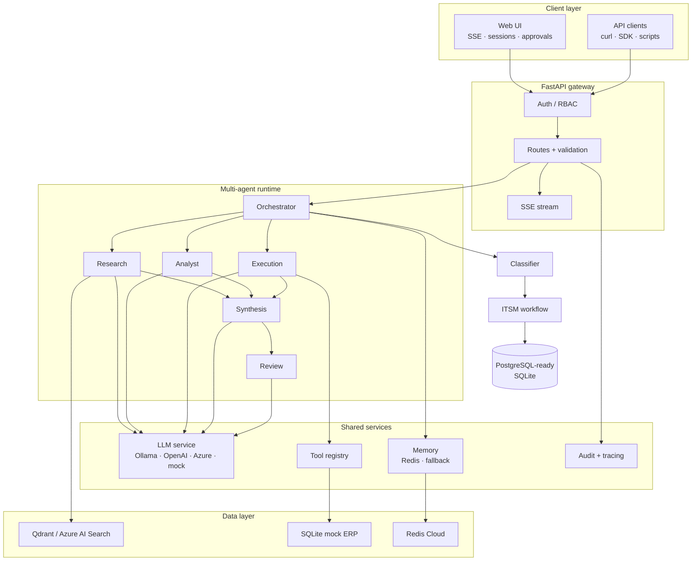
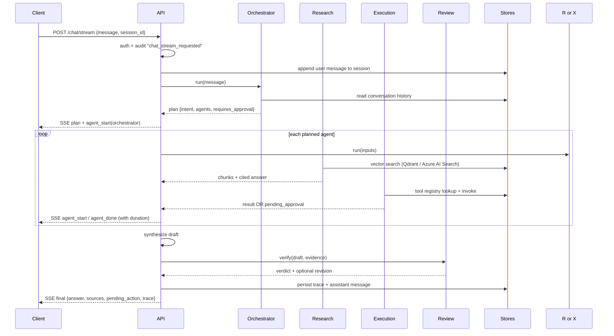
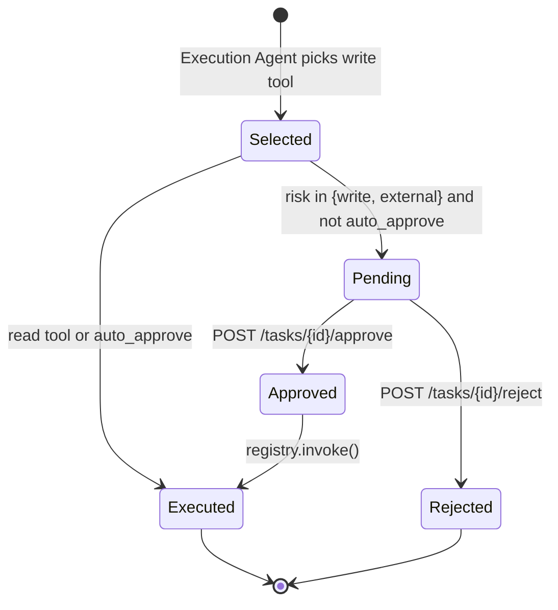

# Architecture

This document describes how the Multi-Agent Enterprise Assistant is designed, how requests flow through it, and how the deployment topology works.

---

## 1. System overview



**Design principles**

1. **Single LLM instance** — all agents share one local model (CPU-friendly); each has a distinct system prompt and permissions.
2. **Provider abstraction** — agents never call Ollama/Azure directly; they use `LLMService`.
3. **Graceful degradation** — every external system is optional with a working fallback.
4. **Human-in-the-loop** — consequential actions are never automatic.
5. **Observability** — every stage emits progress events, timings and audit records.

---

## 2. Request lifecycle



**Event types emitted over SSE:**

| Event | Payload highlights |
|---|---|
| `session` | `session_id`, `task_id` |
| `plan` | `intent`, `agents`, `requires_approval`, `reasoning` |
| `agent_start` | `agent`, `label` |
| `agent_done` | `agent`, `duration_ms`, plus stage-specific data |
| `final` | `final_response`, `agent_results`, `sources`, `pending_action`, `review`, `trace` |
| `error` | `message` |

---

## 3. Memory model

| Store | Contents | Backend |
|---|---|---|
| Session history | User/assistant messages per `session_id` | Redis list with TTL, in-process fallback |
| Task context | Orchestrator plan, tool results, pending approvals, trace | Redis JSON with TTL |
| Knowledge base | Document chunks + embeddings | Qdrant / Azure AI Search |
| Mock ERP | Employees, IT tickets | SQLite (`data/enterprise.db`) |

The in-process fallback is **module-level and shared** across all `MemoryStore` instances, so task context survives between agents within a process. Redis is probed once per process, not on every request.

---

## 4. Approval flow



The pending action (tool name, validated arguments, risk) is stored in task context. Approval executes it through the same registry; rejection records the decision and appends a message to the session. Every transition is audited.

---

## 5. Provider abstraction

```text
                 ┌──────────────────┐
Agents ────────► │   LLMService     │
                 └────────┬─────────┘
        ┌─────────────────┼─────────────────┐
        ▼                 ▼                 ▼
   Ollama native     OpenAI/Azure      Deterministic mock
   (/api/chat,       SDK + optional     (no credentials)
   /api/embed,       managed identity)
   think:false)
```

Switching providers is configuration-only — no agent code changes. Placeholder or empty credentials are ignored automatically, so a half-filled `.env` falls back safely.

---

## 6. Deployment topology

**Local:** Ollama (host) + Qdrant Cloud + Redis Cloud, FastAPI on `127.0.0.1:8000`.

**Docker Compose:** app + Qdrant + Redis containers with healthchecks and persistent volumes; Ollama on the host via `host.docker.internal`.

**Azure (optional):** Container Apps (app) + Azure AI Search + Redis Cache + Key Vault + Log Analytics, provisioned by [`azure/main.bicep`](../azure/main.bicep) via `azd`. Managed identity grants RBAC to OpenAI and Search.

See [Azure deployment guide](../AZURE_DEPLOYMENT.md) for details.

---

## 8. ITSM service desk

The `itsm` intent runs a dedicated workflow instead of the RAG/analysis pipeline:

```text
Classification Agent (category, priority, department)
        ↓
RAG troubleshooting hints (IT documentation)
        ↓
Service request created (pending_approval, SLA)
        ↓
Admin approval queue → priority override → skill-based technician assignment
        ↓
Status history + employee tracking
```

The Review Agent is intentionally skipped for ITSM intents — ticket creation is deterministic and a groundedness rewrite could hallucinate a different ticket ID. See [ITSM guide](ITSM.md).

---

## 7. Observability

- **Traces** — `TaskTrace` records each agent's duration and outcome; available inline in `final` and at `GET /tasks/{id}/trace`.
- **Audit** — JSON-lines file `logs/audit-YYYY-MM-DD.log` + in-memory ring buffer exposed via `GET /audit`.
- **UI** — the pipeline stepper shows live agent activity and per-step durations; the message meta line shows intent, pipeline path, review verdict and total latency.
