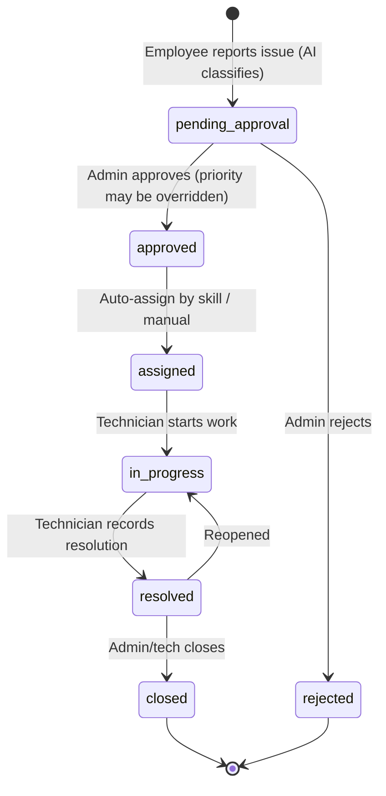

# ITSM Service Desk

The assistant is now an **Enterprise Knowledge + IT Service Management** platform: employees report problems in natural language, AI classifies and routes them, administrators approve, technicians resolve, and employees track every step.

---

## Lifecycle



Every transition is persisted in `ticket_status_history` with actor, role, timestamp and note.

---

## Two ways to create a request

### 1. Chat (knowledge-aware troubleshooting)

```
Employee: "My laptop won't boot, blue screen, urgent presentation tomorrow"
```

1. Orchestrator classifies intent as `itsm`.
2. **Classification Agent** suggests category `hardware`, priority `high`, issue type.
3. RAG searches approved IT documentation (`data/it_support.md`) for troubleshooting steps.
4. A service request is created in `pending_approval` with the suggested priority and an SLA deadline.
5. The answer shows the ticket card, classification, suggested steps and SLA.

The admin can override the suggested priority before approval — AI recommends, humans decide.

### 2. API

```bash
curl -X POST http://127.0.0.1:8000/api/v1/itsm/requests \
  -H "Content-Type: application/json" \
  -d '{"message":"VPN keeps disconnecting","requester":"Ava Patel"}'
```

---

## Roles and endpoints

| Endpoint | Method | Role | Purpose |
|---|---|---|---|
| `/itsm/requests` | POST | user | Classify + create a request |
| `/itsm/tickets` | GET | viewer | List/filter tickets |
| `/itsm/tickets/{id}` | GET | viewer | Track ticket + history |
| `/itsm/tickets/{id}/history` | GET | viewer | Status history only |
| `/itsm/approvals` | GET | admin | Pending approval queue |
| `/itsm/tickets/{id}/approve` | POST | admin | Approve (priority override, assignment) |
| `/itsm/tickets/{id}/reject` | POST | admin | Reject with reason |
| `/itsm/tickets/{id}` | PATCH | user | Technician status/resolution updates |
| `/itsm/technicians` | GET | viewer | Technician directory (skill filter) |

---

## Data model

| Table | Contents |
|---|---|
| `service_requests` | Ticket ID, title, description, classification, priority, status, requester, approval, assignment, resolution, SLA |
| `ticket_status_history` | Every transition with actor, role, note and timestamp |
| `technicians` | Skills-based routing directory (seeded on first use) |

The free SQLite backend is intentional for this free-first project; the repository layer (`app/database/itsm.py`) is isolated so PostgreSQL can replace it later without changing workflow logic.

**SLA hours are configurable** via `ITSM_SLA_HOURS=critical:2,high:8,medium:24,low:72`.

---

## Frontend

The sidebar **Service desk** button opens a role-aware panel with three tabs:

- **My requests** — all tickets with status and Track button
- **Approval queue** — pending requests with Approve / Reject (admin)
- **Technician queue** — assigned/in-progress tickets with Start work / Resolve

Ticket cards also appear inline in chat answers, with a link to the service desk.

---

## Security notes

- Approval and rejection endpoints require the `admin` role.
- AI cannot approve its own requests — `requires_approval` is always true for creation.
- Every ITSM write operation is audited (`itsm_request_created`, `itsm_ticket_approved`, `itsm_ticket_rejected`, `itsm_ticket_updated`).
- With `AUTH_ENABLED=true`, RBAC is enforced on all ITSM endpoints.

---

## Not yet implemented (next roadmap items)

- PostgreSQL migration, department-scoped permissions, JWT auth
- Email/SMTP notifications on approval and resolution
- SLA breach monitoring and escalation
- Dedicated employee / admin / technician dashboards as separate routes
