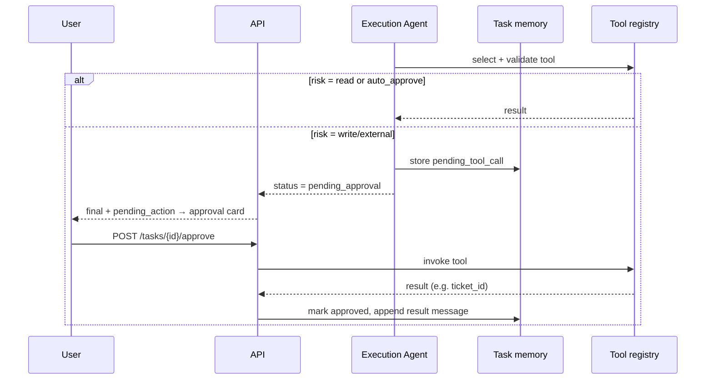

# Tools & Human Approval

The tool framework gives agents controlled, auditable side effects. It lives in `app/tools/`.

---

## Registry design

Each tool is a `ToolSpec` with:

| Field | Purpose |
|---|---|
| `name` | Unique identifier used by the LLM |
| `description` | Shown to the model during tool selection |
| `parameters` | Typed JSON-schema-style list with required/default/enum |
| `risk` | `read`, `write`, or `external` |
| `handler` | Sync or async Python callable |

`ToolRegistry` handles validation (type coercion, required fields, enums), dispatch, and structured results. Unknown or invalid calls return `{status: "error", error: "…"}` instead of raising.

---

## Built-in tools

| Tool | Risk | Parameters | Behavior |
|---|---|---|---|
| `lookup_employee` | read | `query` | HR directory search by name, ID, department or role |
| `list_tickets` | read | `status?`, `category?`, `limit?` | Lists IT support tickets |
| `query_database` | read | `sql` | Read-only SQL over `employees` / `it_tickets`; mutations rejected |
| `create_ticket` | **write** | `title`, `requester`, `category?`, `priority?`, `description?` | Opens an IT support ticket in SQLite |
| `generate_report` | **write** | `report_name`, `sql?`, `format?` | Saves query results as a CSV in `reports/` |

The mock ERP database (`data/enterprise.db`) is created and seeded on first use: 10 employees and 22 IT tickets.

---

## Tool selection

The Execution Agent receives a compact prompt block listing every tool, its parameters and risk. It answers with:

```json
{
  "tool": "create_ticket",
  "args": { "title": "Laptop won't boot", "requester": "Ava Patel", "priority": "high" },
  "reasoning": "User asked to open a support ticket."
}
```

If the model is unavailable or returns an unusable shape, a keyword heuristic fallback maps phrases like *"create a ticket"* or *"find employee"* to the right tool. Arguments are always validated before execution.

---

## Approval workflow



**Security guarantees**

- Approvals require the `admin` role.
- Re-approving a consumed task returns `409`.
- Rejection returns `200` but executes nothing.
- Every transition writes an audit entry (`approval_granted`, `approval_rejected`).
- Direct HTTP execution additionally enforces an allow-list of domains.

---

## Adding a tool

1. Implement a handler function in `app/tools/enterprise.py`.
2. Register a `ToolSpec` in `register_tools()` with accurate risk and parameters.
3. Add a mocked test in `tests/test_tools.py`.
4. The UI needs no change — it renders approval cards generically from `pending_action`.

> Read-only tools need no approval UI changes. Write tools automatically surface an Approve/Reject card in the chat.
